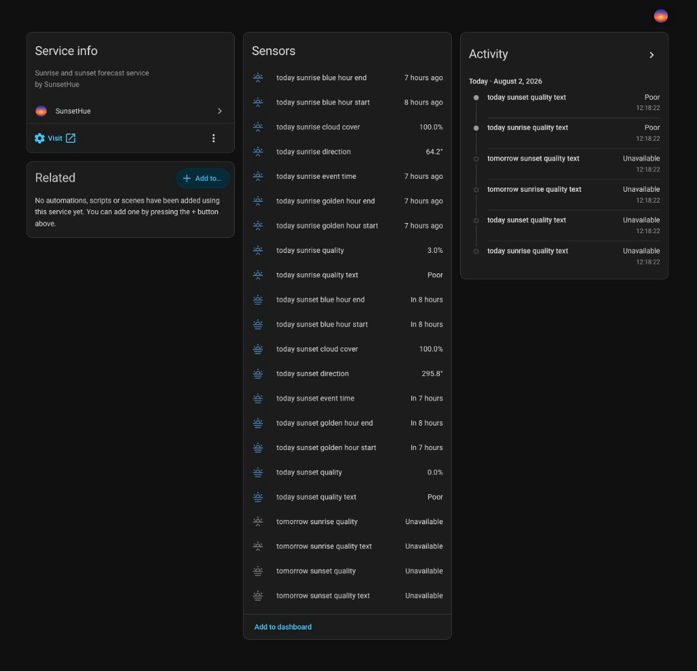

# SunsetHue for Home Assistant

See sunrise and sunset quality forecasts in Home Assistant, including event times and sky conditions for your chosen locations.

## What can I do with it?

- See forecast quality scores and descriptions for sunrise and sunset.
- Show optional cloud cover, direction, event time, and blue- and golden-hour information.
- Create [dashboard cards](docs/dashboard-examples.md) and [automations](docs/automation-examples.md), such as a notification for a promising sunset.

## Requirements and compatibility

- Home Assistant **2026.3.0 or newer** and HACS (or the built-in Home Assistant Marketplace in **2026.11+**), or filesystem access for a manual installation.
- A SunsetHue API key from the [developer portal](https://sunsethue.com/dev-api/portal).
- Forecasts cover up to three local dates: today, tomorrow, and the day after tomorrow, in the selected location's time zone.

## Install with HACS or Home Assistant Marketplace

1. Click the **Open your Home Assistant instance** button above (backwards compatible: opens **HACS** on earlier versions and the built-in **Home Assistant Marketplace** on **2026.11+**), or manually add `https://github.com/andrewtryder/ha-sunsethue` as a custom repository in the **Integration** category.
2. Install a numbered **SunsetHue** release; do not install `main` for normal use.
3. Restart Home Assistant.

For manual installation, copy `custom_components/sunsethue` from a release into `<config>/custom_components/sunsethue`, confirm `manifest.json` is directly inside that folder, and restart Home Assistant.

## First-time setup

1. Go to **Settings → Devices & services → Add integration** and select **SunsetHue**.
2. Enter a location name, API key, latitude, longitude, time zone, and first forecast day.
3. Add a separate entry for each location. Duplicate normalized coordinates are rejected.
4. In the integration options, choose consecutive days, sunrise and/or sunset, refresh interval, and optional detailed entities. The selected days must remain within today through the day after tomorrow.

New installations request today’s sunrise and sunset every six hours. Two event forecasts per refresh are requested by default.

## What you'll see in Home Assistant

Quality percentage and quality text sensors are enabled by default. Optional sensors expose event time, cloud cover, direction, and blue/golden-hour boundaries when the API supplies them. A missing forecast field can make its sensor unavailable; the API may have no model data for a date.

The number of API calls per refresh is **selected dates × enabled event types**. More dates and event types consume more quota. Check the [developer portal](https://sunsethue.com/dev-api/portal) for current pricing and limits and [API usage](docs/api-usage.md) for examples.

## Common problems and troubleshooting

- Restart Home Assistant after installing before searching for the integration.
- Check that files are directly under `custom_components/sunsethue`, rather than in a nested folder.
- Check **Settings → System → Logs** for `sunsethue` errors. Quota exhaustion is reported separately from invalid coordinates or authentication failures.
- See the [troubleshooting guide](docs/troubleshooting.md) for additional help.

## Limitations, safety, and privacy

Forecasts are estimates and depend on the service's available model data. The API key is stored in the config entry and sent to SunsetHue over HTTPS. Diagnostics redact credentials and coordinates; review any diagnostic file before sharing it. Never publish an API key, exact address, or unreviewed diagnostics.

## More documentation

- [Dashboard examples](docs/dashboard-examples.md) and [automation examples](docs/automation-examples.md)
- [Sunset quality notification blueprint](blueprints/automation/sunsethue/notify_sunset_quality_threshold.yaml)
- [API usage](docs/api-usage.md), [API contract](docs/api-contract.md), and [contributing](CONTRIBUTING.md)

## Support and license

Report defects on [GitHub](https://github.com/andrewtryder/ha-sunsethue/issues). This is an unofficial community integration and is not supported by Home Assistant or SunsetHue. See the [license](LICENSE).
